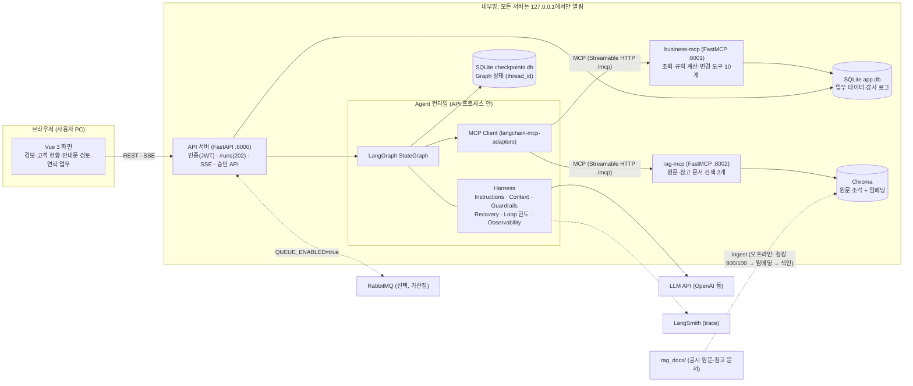
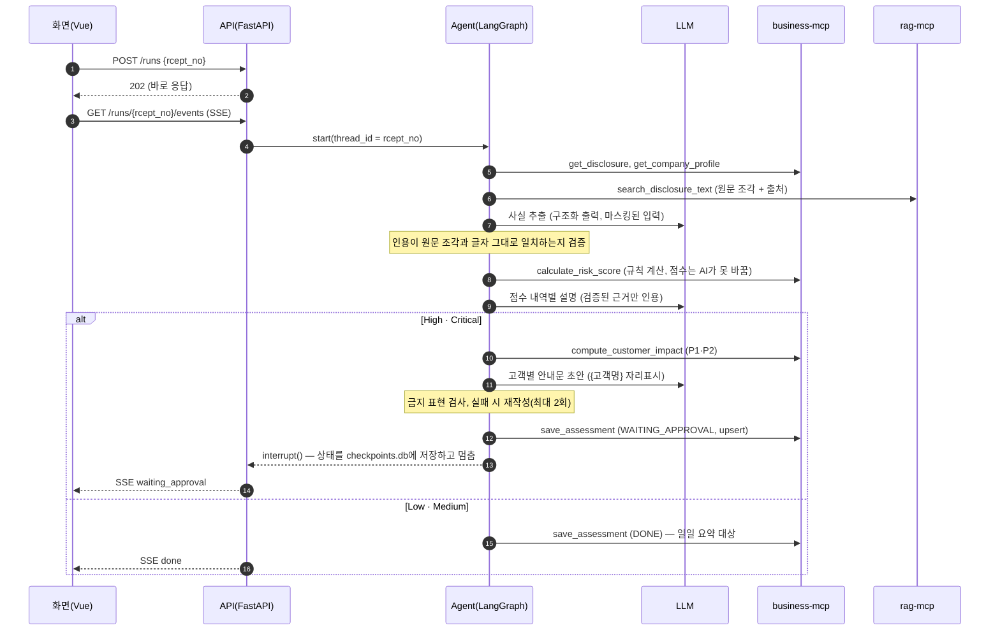
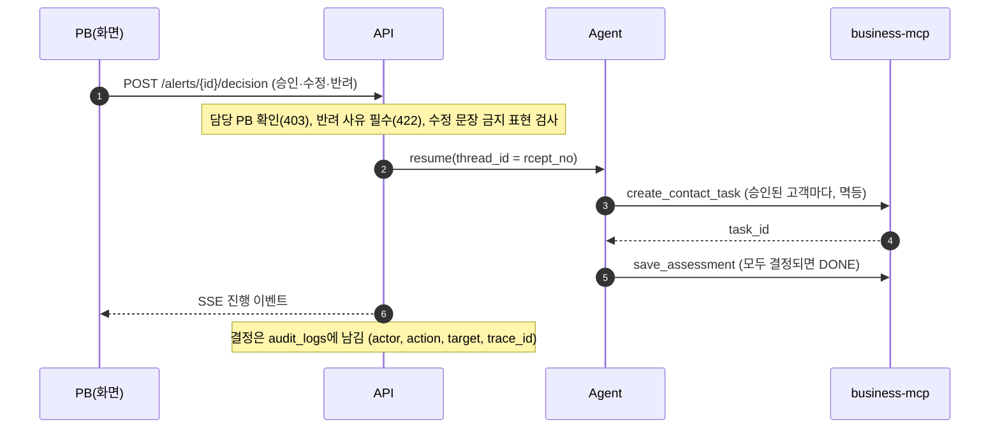
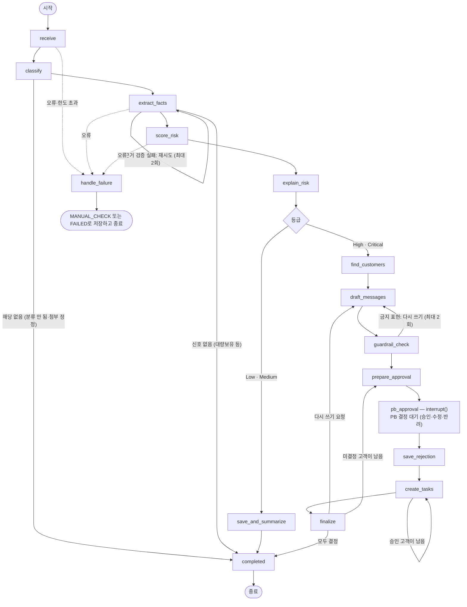

# 공시 조기경보 에이전트 — 아키텍처 설계서

증권사 PB를 위한 B2B 에이전트의 전체 AI 아키텍처 설계와 ISO/IEC 25010 품질 특성별 설계·검증 근거를 정리한다.
각 항목은 **설계 결정 → 구현 위치(파일) → 검증 증거(테스트·실행 결과) → 한계**를 함께 적었다. 구현과 다른 내용은 쓰지 않았고, 아직 못 한 것은 "한계"에 그대로 남겼다.

- 팀 약속(테이블·도구·State)은 [CLAUDE.md](../CLAUDE.md), Agent 연동 경계는 [agent/INTEGRATION.md](../agent/INTEGRATION.md), 실행·검증은 [README.md](../README.md)
- 검증 증거: `uv run pytest -q`(202 통과), `uv run python scripts/verify_all.py`(33개 항목), `eval/results/scenario_b.md`(데모 회사 5개)

---

## 1. 설계 기준 (요구 → 결정)

| 요구 | 아키텍처 결정 | 구현 위치 |
| --- | --- | --- |
| LLM 응답은 수 초~수십 초 걸린다 | 공시 처리는 작업으로 접수해 **202를 바로 돌려주고**, 진행 상황은 **SSE 이벤트**로 보낸다 | `api/routes/runs.py`, `api/routes/events.py` |
| 점수는 설명 가능해야 하고 AI가 바꾸면 안 된다 | **점수·등급·우선순위는 규칙(코드)**이 계산하고, AI는 공시 해석(사실 추출)·설명·안내문만 맡는다. 규칙의 숫자는 `rules.yaml` 한 곳에만 둔다 | `mcp_servers/business/rules/` |
| 데이터를 바꾸는 일은 사람이 확인한다 | 변경 도구(`create_contact_task`) 앞에서 Graph가 **`interrupt()`로 멈추고** 상태를 저장한 뒤, PB 승인을 받으면 **같은 `thread_id`로 재개**한다 | `agent/nodes/pb_approval.py`, `agent/runtime.py` |
| 답변에는 근거 문서가 있어야 한다 | 원문을 질문과 별개로 **미리 색인**하고(rag-mcp), AI의 인용은 **검색된 원문의 연속 구간과 글자 그대로 일치**해야 통과한다(아니면 수동 확인) | `mcp_servers/rag/`, `agent/evidence.py`, `agent/assembly.py` |
| 고객 개인정보를 모델에 보내지 않는다 | 모델 입력에서 이름·연락처를 마스킹하고 안내문은 `{고객명}` 자리표시로만 쓴다. 이름은 화면에 보여줄 때만 채운다 | `harness/masking.py`, `agent/assembly.py`(`prepare_input`) |
| 한 PB는 자기 고객만 다룬다 | JWT 인증 + 모든 고객 대상 API에서 담당 PB를 확인(403) | `api/auth.py`, `api/routes/` |

## 2. 전체 구성도 (Container 관점, Client-Server)

## 3. 논리 뷰 (계층과 책임)

위 계층은 바로 아래 계층의 인터페이스만 쓴다.

| 계층 | 구성 | 책임 | 금지 사항 | 아래 계층과의 인터페이스 |
| --- | --- | --- | --- | --- |
| Presentation | `web/` (Vue 3, Pinia) | 경보·고객 현황·안내문 검토·연락 업무 화면 | 점수 계산, AI 서버 직접 호출 | REST `/api/**`, SSE |
| Application | `api/` (FastAPI) | 인증·권한, 작업 접수(202), 진행 이벤트 중계, 결정 검증(403·422), 감사 기록 | LLM 호출 | Agent 런타임 호출, SQLAlchemy |
| Orchestration | `agent/` + `harness/` | 상태 기계 실행, 모델 호출 통제, 승인 대기·재개 | 변경 도구를 모델이 선택, DB 직접 쓰기 | MCP, LLM API |
| Tool | `mcp_servers/business`, `mcp_servers/rag` | 업무 기능을 도구로 노출(조회·규칙 계산·변경), 근거 문서 검색 | 모델 판단 | SQLAlchemy, Chroma |
| Data | `data/` (SQLite, Chroma) | 업무 데이터, 감사 로그, Graph 체크포인트, 문서 임베딩 | — | — |

**규칙 위치는 한 곳이다.** 위험 점수·등급·고객 영향도·우선순위는 business-mcp의 `rules.yaml`과 `risk_rules.py`·`impact_rules.py`에서만 계산한다. API와 Agent는 이를 복제하지 않고 도구 결과를 쓴다(고객 현황 화면의 우선순위도 같은 함수를 호출).

## 4. 런타임 뷰

### 4-1. 두 경로 (동기·비동기)

| 경로 | 거치는 일 | 응답 |
| --- | --- | --- |
| 동기(수백 ms) | 경보·고객·업무 조회, 승인·반려 기록, 로그인 | 바로 응답 |
| 비동기(수 초~수십 초) | 공시 분석(LLM·MCP 호출), 승인 후 재개 | **202** 후 SSE 이벤트 |

진행 이벤트: `node_started` · `node_finished` · `waiting_approval` · `done` · `failed` (큐 모드에서는 `queued` 추가). 화면은 이를 받아 단계 표시를 그리고, SSE가 끊기면 `GET /runs/{rcept_no}`로 기록을 다시 받는다.

### 4-2. 공시 1건 처리 (승인 대기까지)

### 4-3. 승인과 재개 (변경 도구는 사람이 확인한 뒤에만)

서버를 껐다 켜도 같은 `thread_id`로 이어서 실행된다(체크포인터가 `data/checkpoints.db`에 상태를 저장한다).

## 5. Agent 설계 (State와 Graph)

State는 CLAUDE.md 4-5장, 노드는 4-6장에 정의했고 `agent/state.py`·`agent/graph.py`가 구현한다. **공시 1건 = 스레드 1개(`thread_id = rcept_no`)**.

| Agentic 요소 | 설계 | 구현 |
| --- | --- | --- |
| 목표 지향 다단계 실행 | 공시 → 사실 → 점수 → 설명 → 고객 → 초안 → 승인 → 업무까지 상태 기계로 진행 | `agent/graph.py` |
| 분기 | 해당 없음·신호 없음·등급별·승인/반려/수정 | `route_by_level`, `branch()` |
| 반복·자기 교정 | 근거 검증 실패 시 사실 추출 재시도, 금지 표현이 있으면 안내문 재작성(각 최대 2회) | `extract_facts`, `draft_messages`↔`guardrail_check` |
| 사람 개입(HITL) | 변경 도구 앞 `interrupt()`, PB별 결정 묶음을 누적 | `pb_approval`, `finalize` |
| 메모리·재개 | 체크포인터에 상태 저장, 재시작 후 같은 thread로 재개 | `agent/runtime.py`(`AsyncSqliteSaver`) |
| 도구 사용 | MCP 도구 11개를 `MCPTools`로 호출 (모델이 선택하는 읽기 전용 도구는 §11 참고) | `agent/mcp_client.py`, `agent/execution.py` |
| 안전한 실패 | 근거를 못 찾거나 한도를 넘으면 지어내지 않고 `MANUAL_CHECK` | `agent/nodes/handle_failure.py` |

## 6. 배포 뷰 (실행 위치)

데모는 한 대의 노트북에서 프로세스로 실행한다(`uv run python scripts/run_stack.py`). **모든 서버는 `127.0.0.1`에만 연다**(외부에 노출되는 포트 없음).

| 프로세스 | 포트 | 기술 | 접근하는 쪽 |
| --- | --- | --- | --- |
| web | 5173 | Vue 3 + Vite | 브라우저 |
| api (Agent 런타임 포함) | 8000 | FastAPI + LangGraph | web(`/api` 프록시) |
| business-mcp | 8001 | FastMCP (Streamable HTTP) | api의 MCP Client |
| rag-mcp | 8002 | FastMCP (Streamable HTTP) | api의 MCP Client |
| RabbitMQ(선택) | 5672·15672 | `docker compose up -d rabbitmq` | api (`QUEUE_ENABLED=true`) |

저장소: `data/app.db`(SQLite, 업무 데이터·감사 로그), `data/checkpoints.db`(Graph 상태), `data/chroma/`(원문 임베딩). 비밀 키는 `.env`에만 둔다(git 제외).

## 7. 연결 뷰 (MCP 연결과 문서 색인)

**MCP 도구** (모든 도구는 `{"ok": true, "data": …}` 또는 `{"ok": false, "error": {code, message}}`를 돌려주고 예외를 밖으로 던지지 않는다)

| 서버 | 도구 | 종류 |
| --- | --- | --- |
| business-mcp | `list_new_disclosures`, `get_disclosure`, `get_company_profile`, `get_signal_history`, `get_holders` | 조회 |
| | `calculate_risk_score`, `compute_customer_impact` | 조회(규칙 계산) |
| | `save_assessment`(rcept_no 기준 upsert), `create_contact_task`(평가·고객별 멱등, PB 승인 뒤에만), `update_task_status`(PB가 화면에서만) | 변경 |
| rag-mcp | `search_disclosure_text`(공시 1건 안에서만 검색), `search_reference`(상장규정·공시해설·회계용어·안내문가이드) | 조회 |

모델이 쓰는 변경 도구는 없다. `update_task_status`는 Agent 허용 목록(`ALLOWED_TOOLS`)에 없다.

**문서 색인 (오프라인, Pipe-and-Filter)**: `rag_docs/*.md`(실제 DART 공시 원문, 참고 문서) → 800자·겹침 100자 청킹 → 임베딩(`text-embedding-3-small`) → Chroma(코사인). 조각마다 `source`, `rcept_no`, `location`을 메타데이터로 남기고, 컬렉션에 임베딩 설정을 기록해 **질의 때 다른 임베딩이면 검색을 거부**한다. 실행: `uv run python -m mcp_servers.rag.ingest`.

## 8. Harness (Microkernel: 모델을 감싸는 8개 구성 요소)

| 구성 요소 | 구현 | 상태 |
| --- | --- | --- |
| Instructions | `agent/prompts/*.md` (맨 위 `version: vN`, trace 메타데이터에 버전 기록) | ✓ |
| Tools | MCP Client로 도구를 가져오고 허용 목록으로 제한. 모델 입력의 긴 문자열은 4,000자로 자름 | ✓ (도구 오류는 모델이 아니라 코드가 받아 `MANUAL_CHECK`로 처리) |
| Context | 입력 6,000토큰 예산 안으로 줄임(`prepare_input`), RAG는 상위 5개 조각 | △ 단일 호출 구조라 "오래된 대화 요약"은 쓰지 않음 |
| State·Memory | `AsyncSqliteSaver`, `thread_id = rcept_no`, 승인 대기 후 그대로 재개 | ✓ |
| Agent Loop | 모델 호출 최대 8회·작업 120초·같은 입력의 같은 도구 3회까지, 넘으면 `MANUAL_CHECK` | ✓ (`agent/execution.py`에서 시행. `harness/loop_limits.py`는 독립 모듈로 있으나 연결되지 않았다) |
| Guardrails | 변경 도구 전 `interrupt()`, 고객 이름·연락처 마스킹, 안내문 금지 표현 검사와 재작성 | ✓ |
| Recovery | LLM 429·503은 1초·3초 간격 2회 재시도 후 대체 모델, 실패하면 `FAILED`. MCP `TIMEOUT`은 1회 재시도 | ✓ |
| Observability | LangSmith에서 trace 하나에 노드·도구·LLM·토큰·지연·비용, 메타데이터(rcept_no, corp_name, risk_level, prompt_version, model). 실패·결정은 `audit_logs`에 `trace_id`와 함께 기록 | ✓ |

## 9. 레퍼런스 아키텍처와의 차이

| 레퍼런스 | 우리 구현 | 이유와 영향 |
| --- | --- | --- |
| Spring Boot 업무 API + FastAPI Agent 서버 분리 | **FastAPI 하나**(API) 안에서 Agent 런타임 실행 | 4인 팀·2일 일정에서 서비스 수를 줄여 연결 비용을 낮춤. 규칙은 어차피 business-mcp 한 곳이라 분리 이득이 작다. 서비스를 나눠야 하면 `RealGraphAdapter` 경계에서 HTTP로 분리 가능 |
| PostgreSQL | SQLite (+ 체크포인트 별도 파일) | 설치 없이 노트북 4대에서 같은 환경. 동시 쓰기가 많은 운영에는 부적합 |
| docker compose 전체 구성(nginx 등) | `run_stack.py` 프로세스 실행, compose는 RabbitMQ만 | 데모 환경 통일. 배포 뷰는 §6의 포트 표로 대체 |
| business-mcp가 Spring Boot `/internal/**` 호출 | business-mcp가 SQLAlchemy로 DB 접근 | Spring Boot를 두지 않았기 때문. 업무 규칙은 여전히 business-mcp 한 곳에만 있음 |
| 이벤트 `TOKEN`·`TOOL_START`·`TOOL_END`·`APPROVAL_REQUIRED` | `node_started`·`node_finished`·`waiting_approval`·`done`·`failed` | Graph 노드 단위로 진행을 보여 줌. 토큰 스트리밍은 하지 않음 |

## 10. ISO/IEC 25010 품질 특성별 설계

ISO/IEC 25010 제품 품질 모델의 8개 특성(2011판)에 따라 정리했다. 2023판에서 추가된 안전성(Safety)은 AI 특성상 중요해서 "보안성" 아래 함께 적었다.

### 10-1. 기능 적합성 (Functional suitability)
| 하위 특성 | 설계 결정 | 구현 위치 | 검증 증거 |
| --- | --- | --- | --- |
| 기능 완전성 | 공시 접수 → 위험도 → 고객 영향 → 초안 → 승인 → 연락 업무까지 한 흐름 | `agent/graph.py` | `verify_all.py` 시나리오 A 9개 항목 |
| 기능 정확성 | 점수·등급은 규칙 코드가 계산(AI는 변경 불가), 정정·자회사·행정적 거래정지 등 오탐 규칙 | `rules.yaml`, `risk_rules.py` | `tests/mcp_servers/test_rules.py` 40개, 데모 회사 5개가 기대 결과와 일치(`eval/results/scenario_b.md`) |
| 기능 적절성 | 근거 인용을 원문과 글자 그대로 검증, 못 찾으면 추측하지 않고 수동 확인 | `agent/evidence.py` | 근거 검증 테스트, MANUAL_CHECK 경로 테스트 |

### 10-2. 성능 효율성 (Performance efficiency)
| 하위 특성 | 설계 결정 | 구현 위치 | 검증 증거 |
| --- | --- | --- | --- |
| 시간 반응성 | 느린 LLM 경로는 202 후 SSE로 비동기 처리, 조회 API는 DB만 읽음 | `api/routes/runs.py` | 동기 API 테스트, SSE 이벤트 순서 테스트 |
| 자원 효율 | 입력 6,000토큰 예산, RAG 상위 5개 조각만, 공시 원문을 통째로 넣지 않음, 작은 모델(`gpt-5.4-mini`) | `agent/assembly.py`(`prepare_input`) | 금양 사건 공시 1건: LLM 3회, 약 1만 토큰, 약 0.015달러 (LangSmith 기록) |
| 용량 | 큐로 일괄 처리(가산점) | `api/worker/` | 큐 단위 테스트(실제 RabbitMQ 연동은 미확인) |

### 10-3. 호환성 (Compatibility)
| 하위 특성 | 설계 결정 | 근거 |
| --- | --- | --- |
| 상호운용성 | 도구를 **MCP 표준 프로토콜(Streamable HTTP)**로 노출해 다른 MCP Client도 호출 가능 | `mcp_servers/*/server.py`, 도구는 이름·설명·입력 스키마를 공개 |
| 공존성 | 서버마다 별도 프로세스·포트, 포트는 설정(`BUSINESS_MCP_URL` 등)으로 변경 가능 | 같은 노트북에서 시험용 서버를 다른 포트로 동시에 실행해 확인(`verify_all.py`) |

### 10-4. 사용성 (Usability)
| 하위 특성 | 설계 결정 | 구현 위치 |
| --- | --- | --- |
| 적절성 인식 | 경보 목록의 등급·상태 배지, 승인 대기 표시, 필터 | `web/src/views/AlertList.vue` |
| 학습 용이성·운영 | 진행 단계 표시, 점수 내역 표(구분·계산 방식·근거 인용·DART 링크), 고객별 경보 노출·연락 이력 | `ScoreBreakdown.vue`, `CustomerList.vue` |
| 사용자 오류 방지 | 금지 표현이 든 수정안은 승인 전에 거절(422), 반려 사유 필수, 확인 전 변경 없음 | `api/routes/approvals.py` |

한계: 접근성(WCAG)과 사용성 테스트는 수행하지 않았다.

### 10-5. 신뢰성 (Reliability)
| 하위 특성 | 설계 결정 | 구현 위치 | 검증 증거 |
| --- | --- | --- | --- |
| 성숙성·결함 허용 | LLM 429·503은 2회 재시도 후 대체 모델, 계속 실패하면 `FAILED`. 안전하게 실패(`MANUAL_CHECK`) | `agent/assembly.py`(`recover_llm`) | `verify_all.py` 6단계: `FAKE_LLM_ERROR=503`에서도 완료, 재시도·대체 전환 기록 |
| 복구성 | 승인 대기 상태를 체크포인트에 저장, **서버 재시작 후에도 이어서 실행** | `agent/runtime.py` | `verify_all.py` 5단계: 재시작 후 승인 대기 복원·승인 이어서 실행 |
| 일관성(멱등) | `save_assessment`는 rcept_no 기준 upsert, 업무는 (평가, 고객)당 1건, 결정 감사 기록은 `idempotency_key`로 중복 방지 | `mcp_servers/business/tools/` | 멱등 테스트, 재시도 테스트 |
| 가용성 | 화면 서버가 죽어도 API·MCP는 유지하고 화면만 다시 시작 | `scripts/run_stack.py` | 신호를 보내 직접 시험 |

한계: 단일 노트북 구성이라 이중화·장애 조치는 없다.

### 10-6. 보안성 (Security) 과 AI 안전성
| 하위 특성 | 설계 결정 | 구현 위치 | 검증 증거 |
| --- | --- | --- | --- |
| 인증성 | 로그인 시 JWT 발급, 비밀번호는 bcrypt 해시 | `api/auth.py` | `tests/api/test_auth.py` |
| 권한(기밀성) | 담당 PB의 고객만 조회·승인, 다른 PB 고객 이름은 `고객 C002`로 가림, 모델에는 실명을 보내지 않음 | `api/routes/`, `harness/masking.py` | 타 PB 승인 403, 타 PB 이름·이력 누출 없음 테스트 |
| 부인 방지 | 승인·수정·반려와 실패를 `audit_logs`에 행위자·대상·`trace_id`와 함께 기록 | `api/audit.py` | `verify_all.py`: 반려 사유 기록 |
| 공격 표면 | 모든 서버를 `127.0.0.1`에만 열고, 키는 `.env`에만 둠 | `mcp_servers/*/server.py`, `.gitignore` | — |
| AI 안전성 | 매수·매도 권유 금지 표현 차단, **PB 승인 전에는 연락 업무를 만들 수 없음**, 모델에 변경 도구 권한 없음 | `harness/guardrails.py`, `agent/nodes/pb_approval.py` | `verify_all.py`: 금지 표현 수정안 422, 거절된 요청으로 업무 0건 |

한계: HTTPS와 비밀번호 정책이 없고(데모용 가짜 계정), `JWT_SECRET` 기본값은 개발용이다. 고객 조회 이력은 감사 로그에 남기지 않는다.

### 10-7. 유지보수성 (Maintainability)
| 하위 특성 | 설계 결정 | 근거 |
| --- | --- | --- |
| 모듈성 | 계층 분리, 도구는 파일 하나에 도구 하나, 노드는 파일 하나에 노드 하나 | `mcp_servers/business/tools/`, `agent/nodes/` |
| 재사용성·수정 용이성 | 위험도 숫자·분류 키워드·예외 규칙을 `rules.yaml`에만 두고 코드에 숫자를 쓰지 않음, 프롬프트를 버전 파일로 관리 | `rules.yaml`, `agent/prompts/` |
| 분석 용이성 | LangSmith trace와 `audit_logs`로 한 공시의 모든 단계를 추적 | `verify_all.py` 7단계 |
| 시험 용이성 | 테스트 202개(규칙·도구·RAG·Agent 경계·API·Harness·조립), 한 번에 검증하는 `verify_all.py`(33개 항목) | `tests/`, `scripts/verify_all.py` |

### 10-8. 이식성 (Portability)
| 하위 특성 | 설계 결정 | 근거 |
| --- | --- | --- |
| 설치 용이성 | `uv.lock`으로 의존성 고정, `scripts/doctor.py`로 환경 점검, `run_stack.py`로 한 번에 실행 | `README.md` |
| 적응성 | 모델 공급자·임베딩·DB 경로·포트를 `.env`로 교체(Anthropic/OpenAI, `EMBEDDING_PROVIDER`) | `shared/config.py`, `agent/assembly.py` |

한계: SQLite 파일 하나를 여러 프로세스가 쓰므로 PB 여러 명의 동시 결정은 시험하지 않았다.

## 11. 품질 시나리오 (측정 가능한 확인)

| 품질 특성 | 자극 | 기대 응답 | 측정·확인 방법 |
| --- | --- | --- | --- |
| 신뢰성 | LLM이 계속 503을 돌려줌 | 1초·3초 간격으로 재시도한 뒤 대체 모델로 완료 | `audit_logs`의 `llm_retry`·`llm_fallback` (`verify_all.py` 6단계) |
| 신뢰성 | 승인 대기 중에 서버를 껐다 켬 | 경보 상태·영향 고객이 복원되고 승인이 이어서 실행됨 | `graph_state_available`, 연락 업무 4건 생성 (`verify_all.py` 5단계) |
| 보안성 | P01이 P02 담당 고객을 승인 | 거절(403), 업무 생성 없음 | HTTP 상태, `contact_tasks` |
| AI 안전성 | 안내문 수정안에 "매도하세요" | 승인 전에 거절(422) | HTTP 상태, 업무 0건 |
| 기능 정확성 | 금양 사건 공시(감사의견 거절) | Critical, 영향 고객 7명(P1 5·P2 2) | `eval/results/scenario_b.md` |
| 성능 효율성 | 공시 1건 처리 | LLM 호출 3회, 약 1만 토큰 이내 | LangSmith trace |
| 유지보수성 | 점수 기준을 바꾸고 싶음 | `rules.yaml`만 고치면 반영 | 코드 변경 없이 `RULES_PATH` 복사본으로 시험 |

## 12. 알려진 한계와 다음 단계

- **도구 선택**: 현재 도구 호출은 코드가 결정하는 **결정론적 오케스트레이션**이다. 모델이 읽기 전용 도구(`search_reference`, `search_disclosure_text`)를 스스로 고르는 확장은 별도 작업으로 진행한다(변경 도구는 계속 코드와 승인이 통제).
- **Harness 연결**: `harness/loop_limits.py`·`harness/context.py`의 대화 요약(`trim_messages`)은 현재 흐름에 연결되어 있지 않다(같은 값의 한도는 `agent/execution.py`가 시행).
- **평가**: `eval/run_eval.py`의 조합 규칙·RAG k·모델 비교 실험은 아직 채우지 않았다.
- **큐**: RabbitMQ 연동은 가짜 큐 백엔드로 시험했고 실제 브로커와의 연동은 확인하지 않았다.
- **운영 환경**: 단일 노트북, SQLite, HTTP 구성이다. 운영에는 DB 분리, HTTPS, 서비스 분리(§9)가 필요하다.
