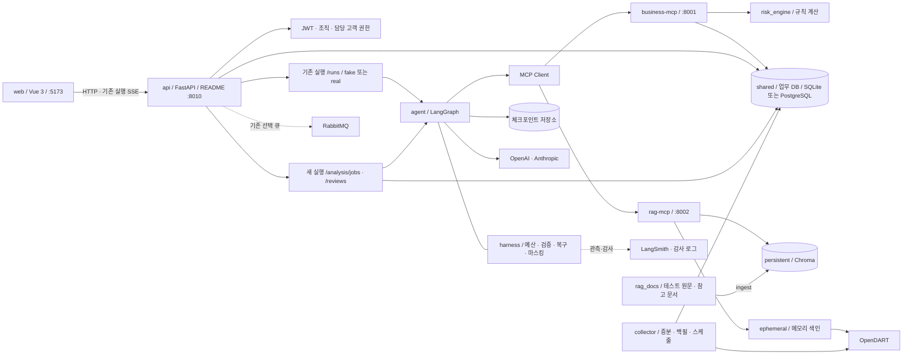
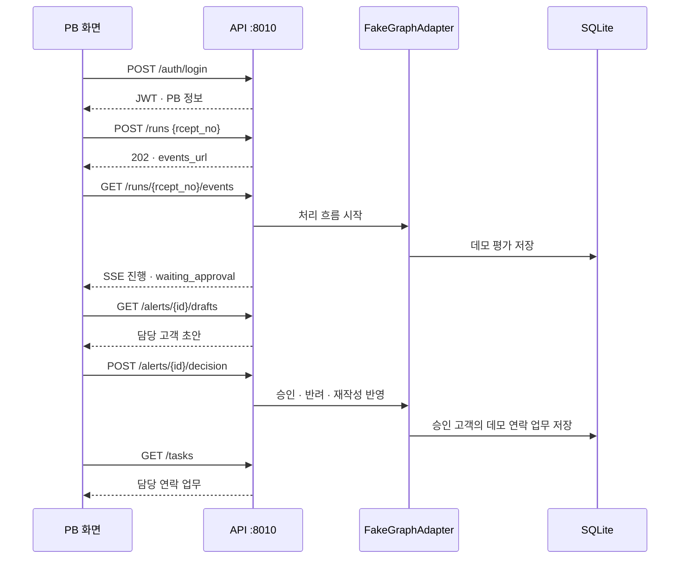
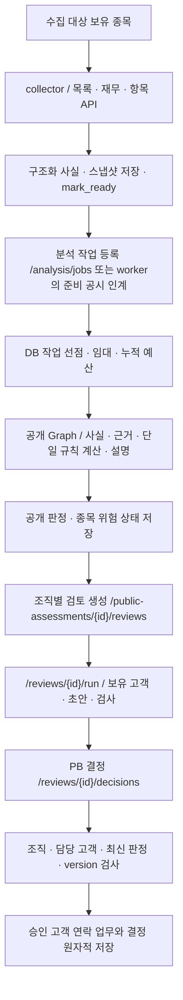

# DARTCH 아키텍처

증권사 PB가 고객 보유 종목의 공시 위험을 조기에 확인하고, 근거와 고객 안내문을 검토한 뒤 연락 업무를 관리하도록 돕는 서비스다.

이 문서는 [README](../README.md)의 실행 방법·기능 범위·한계를 기준으로 구성도와 처리 흐름을 설명한다. API 상세는 [api.md](api.md), 데이터 원천·개인정보는 [SOURCES.md](../data/SOURCES.md)를 따른다. 코드에 있는 구성과 실제 외부 시스템까지 검증한 범위는 구분한다.

## 1. 설계 원칙

| 원칙 | 구현 |
| --- | --- |
| 점수·단계는 규칙이 계산 | risk_engine/rules.yaml·stages.py·financials.py. AI가 숫자·최종 단계를 결정하지 않음 |
| AI는 사실·텍스트 조건·근거·초안 담당 | agent/의 사실·조건 추출, 근거 검증, 설명·안내문 노드 |
| 근거 부족은 수동 확인 | 문서 인용·접수번호·위치·해시·API 원천 검증. 필수 값 누락을 0이나 false로 채우지 않음 |
| 공개 분석과 조직별 고객 대응 분리 | 공개 판정은 공통 결과로 저장, 고객 초안·결정·업무는 조직별 검토로 분리 |
| PB 승인 전 연락 업무 생성 금지 | 기존 Graph 승인 대기·재개, 새 조직 검토의 권한·버전 검사와 DB 저장 |
| 고객명은 모델 입력과 분리 | 마스킹과 {고객명} 자리표시. 공개 공시 원문의 모든 개인 식별 정보 제거와는 별개 |
| 권한과 최신성을 서버가 검사 | JWT·조직·담당 보유 종목·고객·판정 버전·검토 버전 검사 |

## 2. 전체 구성도

구성도는 실제 분석 연결을 포함한 코드 구조다. README의 **fake 데모는 API·웹·SQLite로 흐름을 모사하며 실제 MCP·모델·DART를 호출하지 않는다.** LangSmith 관측은 선택 설정이고, 새 경로는 원문 자동 trace를 제한한다.

## 3. 모듈과 책임

| 경로 | 책임 |
| --- | --- |
| web/ | 로그인·대시보드·종목 상세·고객 현황·안내문 검토·연락 업무 |
| api/ | JWT·권한, 작업 접수·조회, 기존 SSE, 승인·검토·수집 API |
| agent/ | 공시 분석 Graph, 사실·텍스트 조건·근거 검증, 설명·안내문, 승인 대기·재개 |
| agent/adapters/ | MCP·모델·실행기·저장 경계 연결 |
| risk_engine/ | 단계·활성 위험 항목·변경·재무 정책 계산 |
| shared/ | 설정·DB 모델·스키마·조직·작업 임대·입력 버전·사실 해시 |
| collector/ | DART 목록·재무·항목 수집, 증분·백필·구조화 사실 저장·분석 준비 인계 |
| mcp_servers/business/ | 공개 데이터 조회·규칙 계산·평가·위험 상태·업무 저장 도구 |
| mcp_servers/rag/ | 공시·참고 자료 검색, 메모리/영구 색인·사용권·해제 |
| harness/ | 문맥 예산·마스킹·금지 표현·모델/도구 복구·관측 |
| migrations/ | DB 스키마 변경 이력 |
| tests/·eval/·scripts/ | 테스트·사례 평가·데모·실행·유지보수 |

규칙 위치는 risk_engine/이다. 이전 프로젝트의 고객 영향도·P1/P2 우선순위 계산은 현재 고객 대응의 기준이 아니며 보유 고객 전원이 대상이다. 보유 평가금액은 표시·정렬에 사용할 수 있다.

## 4. README 데모 실행

README는 Python 3.11·uv·Node.js에서 다음 구성을 실행한다.

| 프로세스·저장소 | 설정 |
| --- | --- |
| 웹 | Vite :5173, /api 프록시를 http://127.0.0.1:8010으로 연결 |
| API | Uvicorn api.main:app, 127.0.0.1:8010 |
| Graph | GRAPH_ADAPTER=fake, 실제 모델 호출 없음 |
| 새 worker·수집·큐 | PHASE1_RUNTIME_FACTORY 빈 값, COLLECT_DISPATCH_ENABLED=false, QUEUE_ENABLED=false |
| 업무 DB | 기본 sqlite:///data/app.db |
| 데모 데이터 | 회사 5개·공시 594건·가상 PB 2명·고객 20명·보유 42건 |

API의 일반 기본 포트와 run_stack.py는 8000을 사용하지만 README의 개별 실행은 포트 충돌을 피하도록 8010을 지정한다. 원본 run_stack.py에는 --api-port 옵션이 없다. 셸 문법은 Bash 기준이다.

fake도 DB에 결과를 저장한다. Graph 상태는 프로세스 메모리에 있어 재시작 후 상세·초안의 복원이 보장되지 않는다. 같은 접수번호 재처리는 이력에 따라 409가 발생한다. 초기 seed만으로 새 /states의 경보가 모두 생성되는 것은 아니다.

## 5. 실제 분석의 두 경로

### 5.1 기존 직접 처리

GRAPH_ADAPTER=real이면 API의 RealGraphAdapter가 AgentRuntime과 MCP 도구·모델을 사용한다. /runs는 202 접수 후 기존 SSE로 진행을 알리고 /alerts/{id}/decision에서 승인·반려·수정·재작성을 전달한다. 승인 대기는 체크포인트에 저장하고 재개한다. 기존 실행은 접수번호 기반 thread를 사용하며 default 외 조직은 실행 경계에서 차단한다.

기존 Graph는 공시 분류→사실/조건 추출→규칙 계산→설명→대상 고객→안내문 검토→PB 결정→승인 고객의 업무 생성으로 이어진다. 위험 신호가 없는 공시는 정상 종료할 수 있으며 근거 부족·도구 오류와 구분한다. 내부 호환 level이 남아 있어 새 stage와 혼용하지 않는다.

### 5.2 새 공개 분석·조직별 검토

PHASE1_RUNTIME_FACTORY=agent.hosted:build_runtime을 선택하면 API가 공개 분석 worker와 조직별 review executor를 연결한다. QUEUE_ENABLED는 false여야 한다. 수집 dispatcher는 별도 COLLECT_DISPATCH_ENABLED 설정으로 연결한다.

공개 판정은 입력·규칙·평가 기준일·버전으로 식별하고, 조직별 초안·결정은 별도 검토로 저장한다. 작업·검토의 누적 예산과 임대는 DB에서 관리한다. 새 검토 결정은 expected_version을 요구하고 오래된 판정의 승인을 제한한다.

화면의 공시 직접 처리는 /runs이며 /analysis/jobs로 자동 전환되지 않는다. 작업이 등록됐다는 사실만으로 worker 연결·분석 완료를 의미하지 않는다. seed 계정은 PB이며 관리자 승격 API는 없다. 실제 DART·유료 모델·PostgreSQL 전체 검증 한계는 README와 동일하게 유지한다.

## 6. 위험 상태와 설명

| 값 | 의미 |
| --- | --- |
| RED | 즉시 경보 |
| ORANGE | 사건 경보 |
| YELLOW | 재무 경보 |
| COMPOSITE | 복합 위험 |
| WATCH | 관찰 중 |
| NONE | 경보 없음 |

RED·ORANGE·YELLOW·COMPOSITE는 경보 단계다. 여러 활성 단계와 대표 단계를 구분한다. 규칙 기본값은 ORANGE 4 이상·YELLOW 5 이상·복합비율 1.5 이상·관찰비율 0.75다. PB API에는 점수를 제한하고 단계·항목·검증 가능한 근거·빠진 값·타임라인·변경을 제공한다.

문서 근거는 source·quote·rcept_no·location, API 근거는 API명·필드·원천 행·값·단위·기간·기준·데이터 버전으로 추적한다. 원문 해시와 구조화 사실 해시는 대상이 다르다. 안내문 모델 출력은 DraftsOutput의 drafts 사전이며 HTTP의 기존 초안 배열과 새 검토 사전을 구분한다.

## 7. 검색과 원문 수명

| 방식 | 색인·원천 | 수명 |
| --- | --- | --- |
| persistent | rag_docs의 테스트 원문·참고 문서 → ingest → Chroma | 로컬 파일 색인 유지 |
| ephemeral | 공시 원문을 DART에서 받아 정규화·메모리 색인. 참고 자료도 메모리 검색 | holder·진행 중 lease를 관리하고 release. 아직 다른 실행이 사용하면 해제 유예 |

청크는 800자·겹침 100자, 기본 검색 k=5·허용 1~10이다. persistent는 cosine 거리에서 score=1-distance를 반환하며 별도 최소 점수 컷오프는 없다. 새 경로는 검색 조각 전체를 계속 보관하지 않고 필요한 검증 인용·출처·해시·버전을 남긴다. 공시 메모리 색인에는 300청크 상한과 truncated 표시가 있다.

ephemeral의 메모리 해제와 저장소에 유지한 테스트 원문 6건은 다른 범위다. 운영용 원문 획득을 DB 본문→로컬 파일 fallback으로 설명하지 않는다. 공개 공시의 개인 식별 정보는 [출처 문서](../data/SOURCES.md)의 보관·검수 기준을 따른다.

## 8. 저장소·권한·안전장치

| 항목 | 구현·기본값 |
| --- | --- |
| 업무 DB | SQLAlchemy, 로컬 SQLite. PostgreSQL 지원·Alembic 마이그레이션 별도 |
| 체크포인트 | SQLite data/checkpoints.db 또는 PostgreSQL. 새 실행은 R4가 생성한 체크포인터 주입 |
| 문맥 | 6,000 추정 토큰 예산, 긴 도구 문자열 4,000자 제한 등 |
| 실행 예산 | 기본 모델 8턴·120초·같은 도구 한도 3회, 승인 대기와 구분 |
| 복구 | 모델 429·503 2회 재시도→fallback, MCP TIMEOUT 1회 재시도 |
| 권한 | JWT·조직·담당 고객·보유 종목 검사. 권한 부족 403, 일부 자원 조회는 404 |
| 문안 검사 | 매수·매도 권유·단정·점수 노출 검사, 실패 시 재작성·PB 직접 작성 |
| 관측 | 실패·결정 감사 기록과 선택 LangSmith. 새 Graph·LLM 자동 원문 trace 제한 |
| 큐 | 기존 /runs의 RabbitMQ 선택 기능. 새 DB 작업 실행과 동시 활성화 금지 |

README 예시는 로컬 127.0.0.1 API를 사용한다. MCP 기본 호스트는 설정으로 바뀔 수 있고 Compose는 컨테이너 내부 bind를 사용하므로 모든 배포가 127.0.0.1이라고 단정하지 않는다. DB·키·체크포인트·색인은 Git 제출 데이터와 분리한다. SQLite를 PostgreSQL로 선택 변경해도 기존 데이터가 자동 이관되지는 않는다.

## 9. 품질 특성과 확인 방법

| 특성 | 설계·확인 방법 |
| --- | --- |
| 기능 적합성 | 규칙 엔진의 사례 평가, 사실·근거·판정·검토 계약 테스트 |
| 성능 효율성 | 기존 처리의 202·SSE, 검색 조각·문맥·시간·모델 호출 예산. 처리시간·비용 실측과 구분 |
| 호환성 | MCP Streamable HTTP, HTTP·JSON·SSE, 스키마·사실 해시·정규화 버전 검사 |
| 사용성 | 단계·근거·수동 확인·변경 내역, 안내문 검토·연락 업무 화면 |
| 신뢰성 | 체크포인트·DB 임대·재시도·멱등 키·누적 예산, 실제 저장소별 장애 시험 |
| 보안성·AI 안전성 | JWT·조직 분리·담당 고객·최신 판정 검사, 마스킹·가드레일·승인 후 업무 생성 |
| 유지보수성 | 규칙·프롬프트 버전·담당 모듈 분리, API·데이터 계약 |
| 이식성 | uv.lock·npm 잠금 파일, SQLite 로컬 실행·PostgreSQL 선택, 환경 변수 |

코드 검증 위치는 tests/agent·api·business·collector·rag·risk_engine·wiring·demo 등이다. 과거 테스트 개수·시연 비용을 현재 전체 검증 완료의 근거로 반복하지 않는다. 현재 README는 총 50개 저장 사례의 규칙 평가를 설명하며 단건 16/18과 기존 보고서 18/18 불일치, 금양 전체 경보 359일의 원본 검증 대기를 구분한다.

## 10. 알려진 한계

| 한계 | 다음 단계 |
| --- | --- |
| 기존 /runs와 새 /analysis/jobs·/reviews 공존 | 최종 시나리오·화면 연결 종단 검증 |
| 구조화 사실·수치·검증 근거 누락 시 수동 확인 | R2·R3·R4 데이터·근거 계약 연결 |
| DART·유료 모델·PostgreSQL 전체 실행 검증 범위 제한 | 실제 외부 시스템을 포함한 별도 검증 |
| 현재 단건 16/18과 기존 보고서 18/18 차이 | 정책·기대값·코드 정본 대조 및 결과서 통일 |
| 금양 전체 경보 359일 원본 검증 대기 | 당시 재무 원본 확인·재평가 |
| 정상 회사 과경보 | 근거 제공·PB 판단, 정책 변경 시 동일 평가셋 비교 |
| 공개 원문 개인 식별 정보 | 공개 제출 범위·마스킹 검수 |

## 참고

Phase 1(Capstone) 종료 기준은 PR #23 병합 커밋 d6f3191(2026-10-21 11:50 KST)이며 phase1-end 태그가 가리킨다. 태그는 2026-10-25에 소급 생성됐고 Phase 2는 이 태그 이후의 변경을 대상으로 한다.
